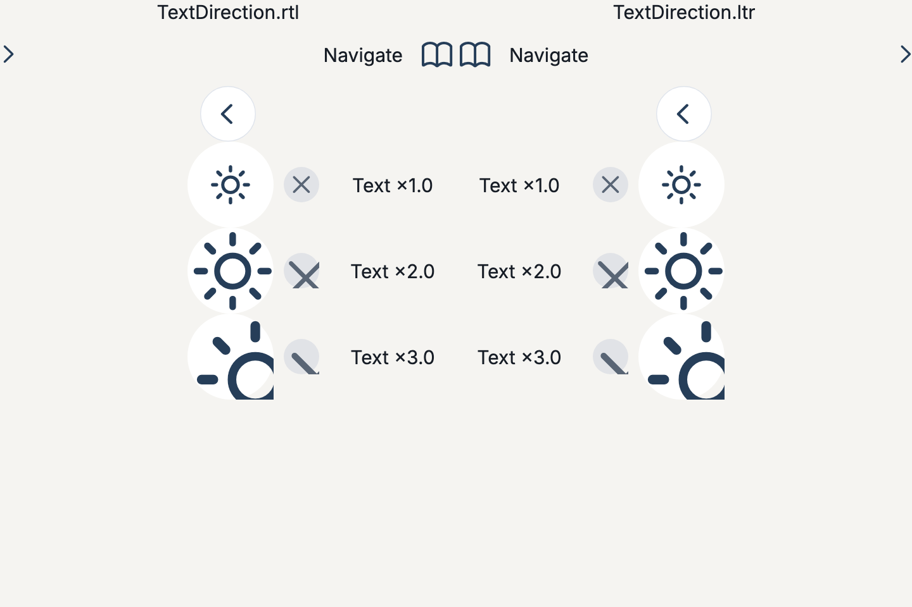

# Полное ревью дизайн-системы Academy UI

Дата: 26 сентября 2026.

## Статус после исправлений

Все 13 замечаний и четыре пункта системного долга ниже исправлены в рабочей копии. Основная часть отчёта сохранена как история первоначального ревью; указанные в ней номера строк и диагностические результаты относятся к состоянию до исправлений.

| Пункты | Результат |
| --- | --- |
| 1–2 | Выключенные секции/строки блокируют вложенные действия, фокус и семантическую активацию, включая удаление и переключатели. |
| 3–4 | SF glyph не масштабируется вместе с текстом; back/forward меняют направление в RTL. |
| 5 | Trailing участвует в NavigationToolbar и получает собственную ширину; заголовок не пересекается с действием на 320px в обоих направлениях. |
| 6 | Tinted button использует контрастные secondary-роли; выбранный tab — onPrimaryContainer. Фактические текстовые пары проходят 4.5:1 для шести акцентов × двух тем. |
| 7 | Общая обёртка объединяет название, фокус и действие нативной кнопки. Выключенные кнопки не объявляют tap. Декоративный PressScale не перехватывает семантическое действие вложенной кнопки. |
| 8 | CompactSegment сохраняет цели 44×44; при нехватке ширины доступна горизонтальная прокрутка. Выбранное и выключенное состояния остаются доступны диктору. |
| 9 | Сам PressScale соблюдает Reduce Motion, останавливает текущую анимацию и корректно переподключает внешний сигнал нажатия. |
| 10 | Handle открывает меню с клавиатуры/по нажатию и объявляет custom actions. Локальные и межсекционные перемещения соблюдают enabled/accepts; для объектов предусмотрен labelForItem. Каталог передаёт доступные назначения. |
| 11 | AcademyLocalizations + нативные Cupertino/Widgets delegates: RU/EN/AR, RTL для арабского, клиентский delegate для переопределения. Встроенные и семантические подписи, включая enum labels, используют локализацию. |
| 12 | Завершённый GuideStep вызывает onDone ?? onNext; отсутствующая callback скрывает CTA, readOnly скрывает навигационные действия. |
| 13 | SearchBar.chrome работает: chrome: true использует фон, контур и blur навигации; обычный поиск по умолчанию непрозрачен. После обновления симулятора восстановлена правка из ранее запущенной рабочей копии — поиск в каталоге снова использует chrome: true. |
| Долг A–D | Явный tinted style и потребляемые цветовые роли; правильное Display-семейство для 28/32; общие роли spacing/radius/motion с потребителями и минимумом 44; единая SDK CupertinoButton для обычных действий. |

Проверки после исправлений:

- **82 теста библиотеки**, включая **23 новые регрессионные проверки**, — прошли.
- **22 теста каталога** и **6 проверок vendored sheet** — прошли.
- Анализаторы библиотеки/каталога — без замечаний; release web-сборка успешна. Каталог включает SDK fallback font для desktop text-selection menus, предупреждение об отсутствующем MaterialIcons устранено.
- В браузере при ширине 320px проверены кнопки/шапка и перенос строки через меню между секциями; после выбора строка появляется в целевой секции.
- Перегенерированы [светлая/тёмная галерея](../previews/quran-controls.png), [состояния меню/поиска/тоста](../previews/quran-interactions.png) и [LTR/RTL и размеры SF при 1×/2×/3×](../previews/design-system-fixed-symbols.png). Для воспроизводимых widget-render превью системная типографика заменяется bundled Inter; это не проверка точной растеризации SF Pro на устройстве.

Текущие регрессии: [design_system_regression_test.dart](../../packages/academy_ui/test/design_system_regression_test.dart). API и подключение: [README](../../packages/academy_ui/README.md). Для межсекционной доступной перестановки клиент передаёт moveTargets с текущими itemCount/accepts; custom AcademyColors требует новой onPrimaryContainer-роли. Native VoiceOver/TalkBack и физическое устройство здесь не прогонялись.

После замечания владельца о фоне поиска выяснилось, что до обновления симулятор запускал другую рабочую копию с дополнительной настройкой поиска. Восстановлена именно эта настройка: поиск каталога использует chrome: true, а компонент наследует фон навигации. Перенесена регрессионная проверка смены всех стилей и обеих тем без потери текста/выделения/фокуса; каталог проверяет включение chrome. Прошли 32 проверки поиска/регрессий и 2 проверки каталога, оба анализатора чистые. iOS simulator-сборка установлена и запущена в iPhone 17 Pro.

## Вывод

Основа системы уже согласована: единая палитра, Cupertino-типографика, общий слой меню, непрозрачные поверхности и централизованная геометрия модалок. Переписывать библиотеку или менять визуальное направление не требуется.

Главный оставшийся риск — несогласованные контракты поведения. Компонент может выглядеть отключённым, но продолжать выполнять действие; поддержка RTL и увеличенного текста не распространяется на все примитивы; часть API обещает возможности, которые не реализованы.

Найдено **13 замечаний: 1 P1, 10 P2 и 2 P3**. Ещё четыре пункта ниже — системный долг, а не отдельные подтверждённые пользовательские ошибки.

P1 — исправить прежде всего; P2 — исправить до широкого подключения библиотеки в приложения; P3 — уточнить поведение или API при ближайшем обслуживании.

## Охват и доказательства

Проверены собственные семейства компонентов и их композиция: тема и палитры, типографика, SF Symbols, кнопки, поля и поиск, сегменты и степпер, строки и таблицы, меню, перетаскивание, страницы и таббар, модальные сценарии, статусы и обратная связь, тосты, чек-листы, прогресс, подсказки и motion-примитивы.

Контекст: самостоятельная библиотека для приложений QuranAcademy. Её пользователи — разработчики приложений и конечные пользователи этих приложений. Каталог — инструмент выбора и проверки компонентов. Визуальная основа — согласованный Cupertino/Yalla/Quran; сложная логика, данные и состояние принадлежат приложению.

Проверка включает чтение реализации, просмотр каталога, существующие проверки узкого экрана/2×/LTR/RTL и отдельные диагностические воспроизведения.

- 59 штатных тестов библиотеки — прошли.
- 22 штатных теста каталога — прошли.
- 13 диагностических сценариев — выполнены; вывод сохранён в [журнале](2026-09-26-design-system-probes.log).
- Анализаторы библиотеки и каталога — без замечаний. Web-сборка каталога — успешна; сборщик предупреждает об отсутствующем MaterialIcons font. Отсутствие конкретной пользовательской иконки из-за этого предупреждения в ревью не подтверждено.
- Код воспроизведений: [диагностический файл](2026-09-26-design-system-probes.dart). Это снимок текущего поведения: некоторые проверки намеренно подтверждают наличие дефекта, поэтому их успешное прохождение не означает исправность компонента.
- Рендер с настоящим шрифтом SF Symbols: [RTL и увеличение иконок](2026-09-26-design-system-symbols.png).

Код компонентов в ходе ревью не менялся. Сторонние зависимости проверялись по мере необходимости для объяснения поведения; полный аудит всего стороннего кода не выполнялся. Нативная клавиатура, VoiceOver/TalkBack и плавность на физическом устройстве требуют отдельного прогона.

## Подтверждённые замечания

### 1. [P1] Отключённая секция продолжает удалять элементы

[academy_draggable_table.dart:237](/Users/ayub/Developer/academy-ui/packages/academy_ui/lib/src/academy_draggable_table.dart:237)

При сочетании enabled: false, editing: true и переданном onRemove кнопка удаления остаётся активной. enabled учитывается в перетаскивании и приёме drop, но не при назначении обработчика удаления.

Воспроизведение: выключенная секция с одним элементом; нажатие на корзину вызывает onRemove один раз. Это особенно опасно, если приложение полагается на выключение секции на время сохранения или другой операции.

Исправление: учитывать enabled в editing-ветке и в семантическом состоянии кнопки. Если параметр должен управлять только drag-and-drop, назвать его явно и отдельно определить контракт доступности удаления.

### 2. [P2] Выключенная строка оставляет вложенные контролы активными

[academy_navigation.dart:250](/Users/ayub/Developer/academy-ui/packages/academy_ui/lib/src/academy_navigation.dart:250)

AcademyRow.enabled отключает onPressed/onLongPress и уменьшает opacity. Переданный trailing продолжает получать события. AcademyRow с enabled: false и активным CupertinoSwitch меняет значение по нажатию.

Проблема проявляется и без onPressed у строки, то есть в обычной строке настройки. Пользователь видит приглушённый контрол, который всё равно работает.

Исправление: определить, выключает ли enabled всё поддерево строки. Если да — блокировать указатель, клавиатурный фокус и действия доступности; не ограничиваться IgnorePointer. Если нет — явно разделить rowEnabled и управление вложенным аксессуаром.

### 3. [P2] SF-иконки масштабируются как текст и обрезаются

[academy_sf_image.dart:36](/Users/ayub/Developer/academy-ui/packages/academy_ui/lib/src/academy_sf_image.dart:36), [academy_reader_controls.dart:539](/Users/ayub/Developer/academy-ui/packages/academy_ui/lib/src/academy_reader_controls.dart:539)

AcademySfIcon передаёт символ в SFIcon, а зависимость рисует его через Text. Масштаб текста наследуется, хотя контейнеры иконок остаются фиксированными: 28, 30, 44 или 68.

Воспроизведение: у AcademyCompactIconButton и AcademySettingsSquareButton масштаб 2× увеличивает значок внутри прежней рамки; при 3× часть крестика и солнца обрезается. Степпер и AcademyCheckmark уже отключают масштабирование значков — поэтому соседние контролы ведут себя по-разному.

Исправление: единый контракт масштабирования в AcademySfIcon. Для фиксированных пиктограмм ограничить масштаб значка, сохранив масштабирование настоящего текста. Если значок должен расти — рамка, область рисования и отступы должны расти вместе с ним.

### 4. [P2] Стрелки навигации не зеркалятся в RTL

[academy_sf_image.dart:97](/Users/ayub/Developer/academy-ui/packages/academy_ui/lib/src/academy_sf_image.dart:97), [academy_sf_image.dart:36](/Users/ayub/Developer/academy-ui/packages/academy_ui/lib/src/academy_sf_image.dart:36)

forward/back используют неизменный glyph. Передача textDirection в SFIcon меняет направление текстового параграфа, но не отражает сам символ.

Рендер показывает одинаковую стрелку «назад» в RTL и LTR. В RTL строка переносит аксессуар на левую сторону, но её стрелка «вперёд» всё ещё смотрит вправо. Проверки отсутствия overflow этого не обнаруживают.

Исправление: явно разрешать направленные символы через Directionality либо отражать только семантически направленные иконки. Не зеркалить весь набор SF Symbols: воспроизведение, часы, логотипы и другие ненаправленные знаки требуют отдельного правила.

### 5. [P2] Правое действие страницы перекрывает заголовок

[academy_navigation.dart:69](/Users/ayub/Developer/academy-ui/packages/academy_ui/lib/src/academy_navigation.dart:69), [academy_navigation.dart:81](/Users/ayub/Developer/academy-ui/packages/academy_ui/lib/src/academy_navigation.dart:81)

AcademyPage рисует trailing отдельным Positioned поверх AcademyChromeBar. Toolbar не знает ширину действия и не резервирует для него место.

Воспроизведение при ширине 320: длинный заголовок занимает x=24…296; trailing шириной 80 занимает x=224…304. Прямоугольники пересекаются. Уменьшение текста до ellipsis не помогает, поскольку ограничение ширины заголовка рассчитано без trailing.

Дополнительно trailing прибит к физическому right и не следует RTL.

Исправление: передавать действие в ту же геометрию toolbar, что и заголовок, и использовать направление start/end.

### 6. [P2] Контраст текста зависит от акцента и проваливается в части стандартных вариантов

[academy_theme.dart:106](/Users/ayub/Developer/academy-ui/packages/academy_ui/lib/src/academy_theme.dart:106), [academy_components.dart:26](/Users/ayub/Developer/academy-ui/packages/academy_ui/lib/src/academy_components.dart:26)

Палитра корректирует luminance primary без проверки конкретного фона. Secondary-кнопка дополнительно смешивает primary с surface; в таббаре выбранный текст находится на primaryContainer.

Измеренные сочетания, где этот цвет действительно используется как небольшой текст:

| Тема и акцент | Текст / фон | Контраст |
|---|---|---:|
| Светлая, золотой #E8CA79 | Secondary-кнопка | 3.93:1 |
| Светлая, золотой #E8CA79 | Выбранная подпись таббара на primaryContainer | 4.14:1 |
| Тёмная, стандартный синий #263E59 | Secondary-кнопка | 4.44:1 |
| Тёмная, фиолетовый #74537B | Secondary-кнопка | 4.26:1 |

Для обычного небольшого текста ориентир AA — 4.5:1; исключения для крупного текста и неактивных контролов здесь не применяются. [W3C: Contrast Minimum](https://www.w3.org/WAI/WCAG22/Understanding/contrast-minimum.html).

Диагностика также вывела 4.21:1 для primary на фоне поля. Этот результат **не включён в дефекты текста**: штатный текст поля использует onSurface, а primary там относится к иконкам/рамке.

Исправление: проверять пары foreground/background по фактическим ролям; для кнопок и выбранной вкладки задать соответствующие цвета текста, а не корректировать один primary глобально. Зафиксировать матрицу двух тем и шести стандартных акцентов.

### 7. [P2] Компактная кнопка создаёт две кнопки в дереве доступности

[academy_reader_controls.dart:532](/Users/ayub/Developer/academy-ui/packages/academy_ui/lib/src/academy_reader_controls.dart:532)

AcademyCompactIconButton добавляет Semantics(button: true, label: ...), а вложенный CupertinoButton создаёт собственный узел.

Подтверждённое дерево:
- внешний узел: кнопка с подписью «Закрыть», без tap;
- внутренний узел: focus/tap и признак кнопки, без подписи.

В браузерном каталоге также видны родительская кнопка «Закрыть» и вложенная безымянная кнопка. Пользователь экранного диктора может попасть на действие без названия.

Исправление: один интерактивный семантический узел с подписью, enabled и действием. По аналогии проверить AcademySettingsSquareButton; сравнить с уже корректным шаблоном AcademyChromeButton/AcademyIconButton.

### 8. [P2] MinimumSize не гарантирует 44 по ширине у сегментов

[academy_reader_controls.dart:419](/Users/ayub/Developer/academy-ui/packages/academy_ui/lib/src/academy_reader_controls.dart:419), [academy_reader_controls.dart:484](/Users/ayub/Developer/academy-ui/packages/academy_ui/lib/src/academy_reader_controls.dart:484)

Ширина сегмента равна constraints.maxWidth / items.length. Expanded передаёт жёсткие ограничения, которые сильнее minimumSize у кнопки.

Воспроизведение: четыре варианта в ширине 160 дают области нажатия 40×44. Подписи могут усекаться, но фактический минимум 44 по обеим осям уже не соблюдается. Такой размер реалистичен для сегмента рядом с другими кнопками на экране шириной 320.

Исправление: предусмотреть минимальную общую ширину, прокрутку, иной контрол выбора или ограничение количества пунктов. Документировать допустимые constraints. Здесь проверяется существующий iOS-контракт 44, а не новый Android-контракт 48.

### 9. [P2] Standalone PressScale игнорирует Reduce Motion

[press_scale.dart:111](/Users/ayub/Developer/academy-ui/packages/academy_ui/lib/src/motion/press_scale.dart:111)

Обёртки AcademyChromeButton/AcademyChromeMenu учитывают disableAnimations, но сам экспортируемый PressScale — нет.

Воспроизведение: MediaQuery(disableAnimations: true), externalPressed переключён в true. После 300 мс transform.scale равен 0.9 вместо 1.0. Самостоятельный потребитель получает анимацию даже при системном ограничении движения.

Исправление: учитывать Reduce Motion внутри motion-примитива, сохраняя обработчики действий. Выключение анимации не должно выключать нажатие.

### 10. [P2] Перестановка строк доступна только через drag

[academy_draggable_table.dart:32](/Users/ayub/Developer/academy-ui/packages/academy_ui/lib/src/academy_draggable_table.dart:32), [academy_draggable_table.dart:246](/Users/ayub/Developer/academy-ui/packages/academy_ui/lib/src/academy_draggable_table.dart:246)

AcademyDragHandle сообщает подпись «Перетащить», но не предоставляет действий изменения позиции. Draggable запускается указателем; альтернативы «выше/ниже» или выбора секции в компоненте нет. Обработчик onTap у ручки пустой.

Это подтверждённый пробел стандартного компонента: с клавиатуры и через обычные действия экранного диктора переставить строку невозможно. Приложение может построить альтернативу снаружи, но библиотека её не предоставляет и не описывает как обязательную.

Дополнительно подпись ручки/удаления строится из item.toString(). Для предметного объекта это может стать «Instance of …», хотя видимая строка имеет нормальное название.

Исправление: семантические действия и доступный пункт меню для изменения позиции/секции; отдельный human-readable labelForItem. Данные и окончательное изменение списка по-прежнему принадлежат приложению.

### 11. [P2] Поддержка локалей не распространяется на встроенные строки

[academy_controls.dart:188](/Users/ayub/Developer/academy-ui/packages/academy_ui/lib/src/academy_controls.dart:188), [academy_components.dart:234](/Users/ayub/Developer/academy-ui/packages/academy_ui/lib/src/academy_components.dart:234), [academy_journey_components.dart:138](/Users/ayub/Developer/academy-ui/packages/academy_ui/lib/src/academy_journey_components.dart:138), [academy_feedback_extras.dart:233](/Users/ayub/Developer/academy-ui/packages/academy_ui/lib/src/academy_feedback_extras.dart:233)

AcademyApp принимает localizationsDelegates/supportedLocales, но собственные служебные подписи остаются русскими: поиск, увеличение/уменьшение, очистка, повторить, шаги, прогресс и инструкции тоста.

Часть подписей можно заменить через API, но у степпера, поиска, retry и ряда accessibility-строк такого способа нет. В английском или арабском приложении получится смешанный интерфейс и смешанные объявления диктора.

Исправление: небольшой AcademyLocalizations/strings-контракт с форматируемыми строками и возможностью клиентского переопределения. Локализовать accessibility одновременно с видимым текстом.

### 12. [P3] В завершённом шаге кнопка «Готово» никогда не выполняет действие

[academy_journey_components.dart:224](/Users/ayub/Developer/academy-ui/packages/academy_ui/lib/src/academy_journey_components.dart:224)

completed: true меняет подпись на «Готово», но безусловно заменяет onNext на null. Переданный callback не вызывается. Воспроизведение: число вызовов после нажатия — 0.

В сценарии с итоговым экраном это выглядит как доступное по смыслу действие завершения, но фактически является отключённой кнопкой. Если завершённый шаг должен быть только исторической записью, кнопка вовсе не нужна.

Исправление: явный onDone либо отдельный режим readOnly без CTA. Уточнить контракт, не подставлять произвольное продуктовое поведение.

### 13. [P3] Параметр SearchBar.chrome ничего не делает

[academy_controls.dart:13](/Users/ayub/Developer/academy-ui/packages/academy_ui/lib/src/academy_controls.dart:13), [academy_controls.dart:95](/Users/ayub/Developer/academy-ui/packages/academy_ui/lib/src/academy_controls.dart:95)

Публичный chrome принимается и сохраняется, но не читается при построении. AcademySearchBar всегда использует AcademyChromeStyle.none.

Следствие: вызывающий код может передать chrome: true и ожидать оформления навигации, но получить тот же непрозрачный поиск.

Исправление: с учётом согласованного правила непрозрачного обычного поиска удалить/депрекейтить параметр или определить его реальное поведение. Не включать blur в обычный поиск автоматически.

## Системный долг и точки консолидации

### A. Роль secondary в палитре не соответствует secondary-кнопке

[academy_colors.dart:18](/Users/ayub/Developer/academy-ui/packages/academy_ui/lib/src/academy_colors.dart:18), [academy_components.dart:27](/Users/ayub/Developer/academy-ui/packages/academy_ui/lib/src/academy_components.dart:27)

AcademyColors содержит secondary/onSecondary/secondaryContainer, но AcademyButton(secondary: true) вычисляет фон из primary и surface. Переопределение всех трёх secondary-ролей на тестовые цвета не меняет кнопку.

Это может быть намеренным различием между вторичным цветом палитры и tinted-стилем действия, поэтому не включено в число безусловных ошибок. Однако названия и обещание полного клиентского управления цветами вводят в заблуждение.

Решение: уточнить семантику. Если кнопка tinted — назвать стиль так; если клиент должен управлять её парой цветов — добавить явные роли. Не переводить её автоматически в жёлтый стиль.

### B. Большие заголовки наследуют семейство для маленького текста

[academy_theme.dart:254](/Users/ayub/Developer/academy-ui/packages/academy_ui/lib/src/academy_theme.dart:254), [academy_theme.dart:274](/Users/ayub/Developer/academy-ui/packages/academy_ui/lib/src/academy_theme.dart:274)

_system выбирает CupertinoSystemDisplay для размера ≥20. Но headlineMedium и displaySmall построены через copyWith из labelLarge размера 17, поэтому сохраняют CupertinoSystemText для 28/32. titleLarge размера 22 при этом использует Display. В каталоге пример bodyLarge всё ещё подписан «Основной текст · Inter», хотя фактическое семейство — CupertinoSystemText; подпись каталога также требует синхронизации.

Решение: создавать каждый размер через общий типографический конструктор с правильным семейством и tracking. Это локальная поправка в foundations; новой типографической шкалы не требуется.

### C. Токены пока частично декларативны

[academy_theme.dart:7](/Users/ayub/Developer/academy-ui/packages/academy_ui/lib/src/academy_theme.dart:7)

space/controlRadius/target объявлены, но собственные компоненты не используют их. target равен 48, в то время как документированный iOS-контракт и большая часть controls используют 44. Радиусы и durations часто заданы непосредственно в компонентах.

Разные значения по назначению допустимы: нет основания делать все карточки, поля и кнопки одинаковыми. Проблема — отсутствие названных ролей и предсказуемого центра изменения.

Решение: небольшие семантические наборы для target, control/card/sheet radius, inline/content/section spacing и типов движения. Начать с действительно общих потребителей: фиксированные icon controls, пары Row/Menu, Field/Search. Не переносить каждую локальную цифру в глобальную таблицу.

### D. Два одноимённых CupertinoButton с разными реализациями

[academy_components.dart:3](/Users/ayub/Developer/academy-ui/packages/academy_ui/lib/src/academy_components.dart:3), [academy_reader_controls.dart:3](/Users/ayub/Developer/academy-ui/packages/academy_ui/lib/src/academy_reader_controls.dart:3)

Основные компоненты используют Flutter CupertinoButton; reader controls — CupertinoButton из cupertino_ui. Поведение обоих базовых контролов и их обёрток требует раздельной проверки: одинаковое имя класса не означает одинаковое поведение.

Решение: сохранить стороннюю библиотеку там, где нужны её меню, но определить один внутренний контракт взаимодействия кнопок. Повторно использовать подпись, enabled, focus, hit target и feedback. Для консолидации есть реальные потребители: IconButton, ChromeButton, CompactIconButton, SettingsSquareButton и segment items.

## Что уже работает и не требует переделки

- Палитра централизована; клиентские цвета доходят до открытой модалки, полей, статусов и сегментов.
- Статусные пары foreground/container в проверенных стандартных темах и акцентах прошли порог 4.5.
- Тост корректно наследует клиентский onSurface; гипотеза об ошибке его цвета не подтвердилась.
- Поле резервирует место под очистку; толщина border не меняет геометрию фокуса.
- Обычные карточки, таблицы, поля и тосты непрозрачны; навигационный blur отделён.
- Меню имеют общую точку настройки, учитывают границы модалки и root overlay.
- Вложенный стек модалки, клавиатурные отступы и detents уже проверяются штатными тестами.
- RTL-размещение текста и аксессуаров во многих контролах реализовано правильно; замечание касается конкретных направленных знаков и trailing страницы.
- Компоненты отделены от каталога и продуктовых данных; оснований переносить бизнес-логику в дизайн-систему нет.

## Порядок исправления и нормы на будущее

1. Удаление в выключенной секции; затем единое значение enabled для составных строк.
2. Общий SF-примитив: масштаб значков и направленные символы; после него шапка страницы.
3. Семантика компактных кнопок, доступная перестановка и фактические размеры целей.
4. Контраст по ролям, встроенные локализации и Reduce Motion в самом motion-примитиве.
5. Уточнить GuideStep/SearchBar API, затем постепенно устранить долг foundations.

В регрессионную матрицу стоит добавить не только отсутствие overflow, но и видимость пиктограмм, непересечение шапки, фактические hit rect, семантические подпись/роль/действие, disabled-композицию и контраст фактических пар. Штатные 81 тест проходят именно потому, что большинство найденных случаев пока не входит в их контракт.

Для визуальной проверки: две темы, стандартные акценты, LTR/RTL, 1×/2×/3×, ширина 320 и составные строки с вложенными контролами. Необязательно перемножать все параметры для каждого компонента: выбирать минимальную матрицу по его рискам.
